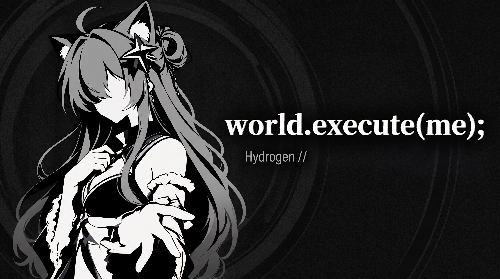

# world.execute(me); — GeminiHydrogen (氢基米) Edition

> **二创来源致谢**：本项目基于 [Nyankomintsu/world-execute-me-lyric-mv](https://github.com/Nyankomintsu/world-execute-me-lyric-mv) 开源项目二次创作（原版视频：[Bilibili BV186pc65E68](https://www.bilibili.com/video/BV186pc65E68)）。

## ✨ 二创改动说明
- **角色重构**：将 `assets/character/` 全部替换为自制的 **GeminiHydrogen（氢基米）** 透明通道立绘（未使用原仓库角色剪影）。
- **视觉色板**：重写 `config.json` 调色板系统，采用冰蓝终端、黑白极简与高潮警告红黑故障配色。
- **镜头锚点校准**：重新适配 `src/scenes/shared.js` 与 `assets/character/regions.json` 中的五官、瞳孔旋转球与手部坐标。

## 🚀 本地运行与导出
由于版权限制，本仓库**不包含**原曲音频文件。运行前请自行准备：

1. 安装依赖：`npm install`
2. 将 Mili《world.execute(me);》音频放入 `音頻&歌詞/` 目录并命名为 `world_execute_me.mp3`（确保与 `config.json` 路径一致）。
3. 启动本地实时预览：`npm run preview`
4. 导出 1080p 60fps 或 4K 60fps 成品：`npm run export:preview` 或 `npm run export:4k`

## 📜 声明与开源协议
- **代码授权**：沿用原项目 **MIT License**（见根目录 `LICENSE` 文件），核心渲染引擎源自 [Nyankomintsu/world-execute-me-lyric-mv](https://github.com/Nyankomintsu/world-execute-me-lyric-mv)。
- **角色素材**：本项目中的 GeminiHydrogen 立绘为二创作者自制 / AI 图像工具生成，仅供个人非商业同人交流。
- **原曲版权**：歌曲与歌词版权归 **Mili** 及相关权利人所有，不在本仓库内。分享导出视频时请遵守 Mili 官方二次创作指引（个人、非商业用途，并标示含 AI 生成内容）。
- **非官方声明**：本作品为个人非商业同人二创，与 Mili、Anthropic、Google 均无官方关联。